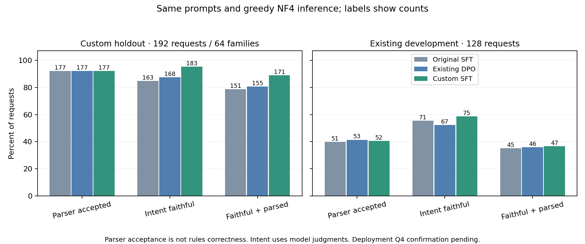
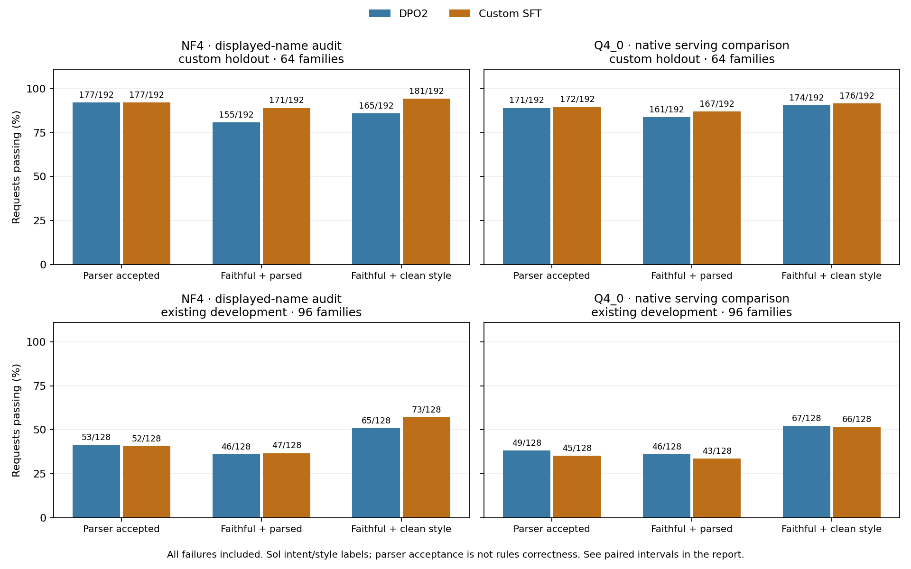
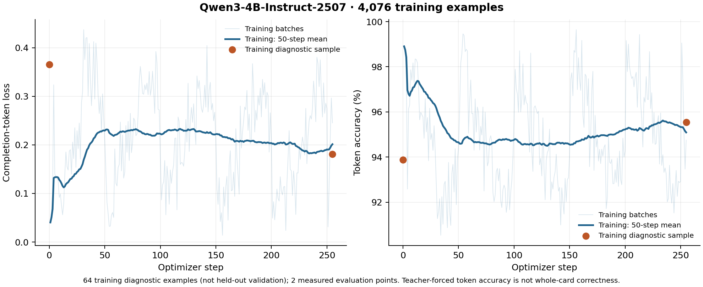

# Additional custom-card SFT pilot

The [corrected HF job](https://huggingface.co/jobs/vishvananda/6aca52ccfee2c90070188f39)
completed on 2026-10-10: **255/255 updates**, followed by all three 320-request
comparisons. Custom-card intent preservation improved on the new holdout;
parser acceptance did not. **The live model remains round-two DPO.** The completed
Q4_0 comparison shows a smaller, uncertain custom-holdout gain and some development
regressions; it does not justify replacing the live model. The display-name audit
below removes the apparent NF4 style regression.

## Held-out generation results

All arms used the same frozen system prompt, unconstrained greedy generation,
2,048-token output limit, and NF4 inference. SFT means the completed original
epoch; DPO is the existing round-two adapter; Custom is the new SFT continuation.
The new holdout has **192 descriptions from 64 unseen card families**.

| Metric | SFT | DPO | Custom SFT |
| --- | ---: | ---: | ---: |
| Schema valid | 192 | 192 | 192 |
| mtgish accepted | 177 | 177 | 177 |
| Intent faithful | 163 | 168 | **183** |
| Faithful and parsed | 151 | 155 | **171** |
| Faithful with clean Oracle style, original judge | 157 | 159 | 144 |

Faithful-and-parsed rose **80.7% → 89.1%** versus DPO, a gain of 8.33 percentage
points (descriptive 95% family-bootstrap interval **+3.65 to +13.54 points**).
Parser acceptance was unchanged at **92.2%**. These requests derive from
parser-filtered, supported single-face custom cards. Their acceptance rate is
not comparable to arbitrary user prompts or the earlier 400-card Oracle test.
Intent labels come from Sol; generation and review share a model family. The
intervals do not account for that dependence or multiple metric comparisons.

The separate existing development panel has 128 requests from 96 families:

| Metric | SFT | DPO | Custom SFT |
| --- | ---: | ---: | ---: |
| Schema valid | 128 | 127 | 128 |
| mtgish accepted | 51 | 53 | 52 |
| Intent faithful | 71 | 67 | 75 |
| Faithful and parsed | 45 | 46 | 47 |
| Faithful with clean Oracle style | 65 | 63 | 68 |

This panel does not establish a broad quality improvement: parser acceptance
was 41.4% → 40.6%, and faithful-and-parsed 35.9% → 36.7% versus DPO. The
original SFT may have seen source cards from this development panel.
See [counts, paired intervals and limitations](evaluation.json).

### Completed style-judge audit (2026-10-11)

The original custom-holdout style regression prompted a controlled audit. The
production prompt requires `CARDNAME` for self-references; the style judge
receives raw JSON and its rubric does not explain that placeholder. Of 39
faithful custom outputs given style score 1, **37 contain CARDNAME**. The
corresponding DPO counts are 5 of 9. Spot checks include conventional wording
such as `Flying\nWhen CARDNAME enters, scry 1.`

All three frozen arms were rejudged with `CARDNAME` replaced by the displayed
face name, only in `oracle_text`. The raw outputs, metadata, parser inputs and
original scores remain unchanged. All six calibration cases passed: equivalent
placeholder/real-name cards passed, while altered quantities, beneficiaries,
missing flying and a substituted life-loss effect failed. Identical displayed
request/card combinations across arms were judged once (715 unique submissions
from 959 schema-valid outputs). The same v3 rubric and Sol/medium were used.

| Faithful with clean Oracle style, audited | SFT | DPO | Custom SFT |
| --- | ---: | ---: | ---: |
| Custom holdout / 192 | 160 | 165 | **181** |
| Existing development / 128 | 67 | 65 | **73** |

Audited custom-holdout intent fidelity is 163/169/184, and faithful-and-parsed
remains **151/155/171**. The latter paired gain versus DPO is still +8.33 points.
The development panel is 70/68/77 faithful and 46/46/47 faithful-and-parsed.
The style regression does not persist under consistent displayed names. This
is a full rejudgment, including deduplication and stochastic judge variation;
it does not prove that every changed label was caused solely by `CARDNAME`.

[Original audit counts](style-audit.json) and
[complete audited counts/intervals/protocol](display-name-audit.json) are retained
alongside the original table. Parser acceptance alone never proves rules
correctness or fidelity to intent.

### Completed Q4_0 serving comparison (2026-10-11)

Both frozen GGUFs generated all 320 requests using the same production prompt,
greedy decoding, seed 17 and 2,048-token limit. This used native llama.cpp on
CPU for an offline quality check; it does not measure browser GPU performance.
All 633 schema-valid outputs received the displayed-name-aware Sol/medium review
(598 unique submissions). The unchanged mtgish workflow checked both arms.

| Metric | Custom holdout: DPO / 192 | Custom holdout: Custom / 192 | Development: DPO / 128 | Development: Custom / 128 |
| --- | ---: | ---: | ---: | ---: |
| Schema valid | 192 | 192 | 125 | 124 |
| mtgish accepted | 171 | 172 | 49 | 45 |
| Intent faithful | 176 | 179 | 71 | 71 |
| Faithful and parsed | 161 | 167 | 46 | 43 |
| Faithful with clean Oracle style | 174 | 176 | 67 | 66 |

Custom-holdout faithful-and-parsed improves **83.9% → 87.0%**, or +3.13 points
(descriptive 95% family-bootstrap interval **−0.52 to +6.77**). Development falls
**35.9% → 33.6%**, or −2.34 points (**−6.11 to +0.79**). Neither establishes a
robust improvement. The earlier +8.33-point NF4 gain does not reproduce at the
same size in the serving quant. NF4 and Q4 also use different inference runtimes;
this is not a controlled test isolating precision alone.

All failures remain in the denominators. Custom has four token-limit failures;
DPO has two plus one missing required field, all in development. Interrupted
CPU requests were resumed only where no completed output had been saved, with
frozen identities and a longer transport timeout. Truncated outputs were not
regenerated for a better answer.

One Adventure per arm reproducibly fails upstream preprocessing: it prints a
diagnostic before an empty JSON array, which the client reports as `parser_error`.
Two isolated retries per card confirmed this. These are separately recorded
workflow failures, counted as not accepted; both outputs also fail intent.

Spot checks found useful gains in exact requested names, but also lost targeting
surcharges and a missing duration on a granted keyword. One apparent development
win has inconsistent judge labels: both copying halves are sorceries, but only
DPO was penalized for the casting restriction. Scores remain frozen; the small
differences should not be treated as definitive wins. Parser acceptance is also
an imperfect proxy: a straightforward mana-adding output was rejected.

[Full counts, paired intervals, failure audit and artifact hashes](q4-comparison.json)
and [SVG graph](review-gates.svg) preserve the results. **Keep DPO2 deployed.**
The next experiment should target error-to-repair behavior and representation
failures, with a fresh held-out repair panel, rather than assuming more of this
same SFT mixture will improve general generation. No repair training has started.

## Training and compute

The candidate continued the completed original **SFT**, with a fresh optimizer,
NF4 QLoRA, rank 16, one epoch, and learning rate 2e-5. Training took **15m30s**;
the corrected job occupied **21m51s** (15:19:12–15:41:04 UTC). Peak allocated
GPU memory was **19.22 GiB**. The final adapter hash changed and artifact
verification checked complete case IDs, source/adaptor hashes, and matching
inference protocols.

The mean training loss was 0.2130. A fixed **64-example training diagnostic**
loss fell **0.3655 → 0.1813**, with token accuracy **93.88% → 95.54%**. These are
training examples, not held-out accuracy. Per-step loss varies with batch
composition; the curve must not be interpreted as test loss.

[Training measurements](training-summary.json), [loss CSV](training-curve.csv),
and [SVG](training-curve.svg) preserve the run outputs. The conservative
combined GPU cost bound for the failed first job and successful recovery is
**$1.584**, below the original $5.01 ceiling; this is not a verified invoice and
excludes teacher/judge usage.

The [first attempt](https://huggingface.co/jobs/vishvananda/6ac9f6cf095c5780893104f7)
finished both baseline generations, then stopped before training because TRL
0.23 froze an already-loaded QLoRA adapter. A trainability assertion caught it.
The corrected pipeline reactivates only the original SFT adapter after trainer
initialization. A regression test reproduces the freeze path, performs an
update, and verifies base weights remain frozen. The recovery reused all 640
baseline outputs only after verifying their hashes, cards, adapters, prompts,
code and inference configuration. There was no automatic paid retry.

## Dataset and reproduction

The frozen dataset contains **4,076 training examples**: 2,038 custom examples
from 511 families plus 2,038 original-training replay examples, including 192
planeswalker examples. One target and six broad descriptions failed review and
were excluded. All detail levels of a family share its split. The 64 new held-out
families are excluded from original SFT training and this continuation.

All 576 selected source targets were checked after conservative normalization;
parsed structures were preserved. Of 575 retained targets, 64 had reminder text
removed, 506 had none, and five retained syntax required by unchanged mtgish.
Sol at medium reasoning generated and independently reviewed three detail levels
in 97 batches. **78.9%** of reported batch input tokens were cached. The
[preparation receipt](preparation.json) records usage without inventing a
subscription-dollar cost. Local preprocessing checked 4,140 completion masks
in 8.68 seconds; training has 2,643,382 tokens, maximum sequence length 1,009.

See [protocol and reproduction commands](../../docs/custom-card-training.md),
[dataset manifest](dataset-manifest.json), and
[configuration](../../configs/custom-sft-pilot.json).
Raw third-party records and candidate weights remain in private staging, outside
Git. There is no automatic publication or model deployment.

For the next task, [Oracle repair training](../../docs/oracle-repair-training.md)
now has an exact-browser-prompt exporter and a parser-checked synthetic pilot.
It has **not been trained**.
