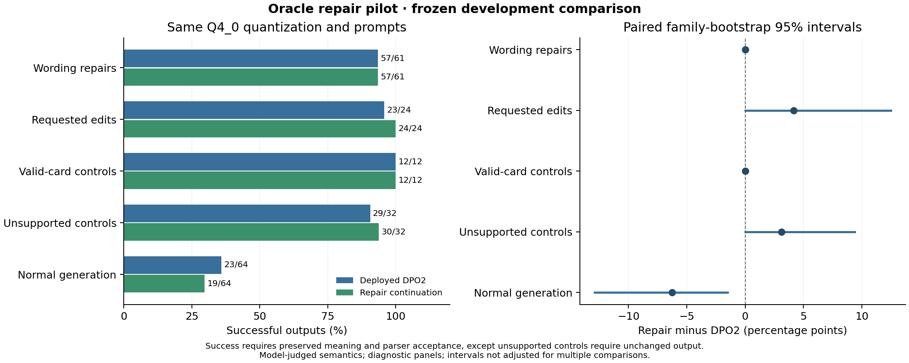
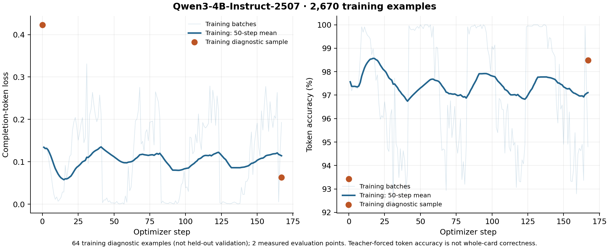

# Oracle repair SFT pilot

**Complete: keep DPO2 deployed.** Wording repair did not improve, while normal
generation regressed. Small gains in editing and preserving unsupported cards
do not justify replacing the general generator or adding a second repair model.

## Results

| Strict successful outputs | DPO2 | Repair SFT | Paired difference, percentage points (95% interval) |
| --- | ---: | ---: | --- |
| Controlled wording repairs | 57/61 | 57/61 | 0.00 (0.00, 0.00) |
| Requested edits | 23/24 | 24/24 | +4.17 (0.00, 12.50) |
| Accepted no-op cards | 12/12 | 12/12 | 0.00 (0.00, 0.00) |
| Unsupported-valid controls | 29/32 | 30/32 | +3.13 (0.00, 9.38) |
| Normal generation, faithful and parsed | 23/64 | 19/64 | −6.25 (−12.90, −1.49) |

Success requires valid schema, preserved metadata and meaning, and mtgish
acceptance. Unsupported-valid controls instead require unchanged output and
semantic approval; neither model made those 32 cards parse. Both models parse
**58/61** controlled repairs and match the target's canonical parse tree on all
58. The strict score is one lower because the judge objects to a retained
pronoun even though both models exactly reproduce that case's reviewed target.
This shared judge false negative does not affect the paired conclusion. Raw
scores are retained alongside the independent parse-tree diagnostic.

Planeswalker wording repairs are **15/16 in both arms**. Starting-loyalty edits
improve **15 → 16/16**, and preservation of unsupported planeswalkers improves
**2 → 3/3**. The two gains preserve fields the baseline omitted: starting
loyalty in one card, and rarity/type metadata in another.

Normal-generation schema validity falls **63 → 59/64**, parser acceptance
**24 → 21/64**, and judged intent fidelity **37 → 32/64**. Three new schema
failures involve planeswalker structure. All 386 generations completed, with
zero truncations and no parser infrastructure failures.

These are diagnostic panels and the intervals are not adjusted for multiple
comparisons. A zero-width paired interval means the observed paired outcomes
were identical, not that true population performance is known exactly.
[Full metrics and model/parser identities](comparison.json) ·
[per-case flags, without source card text](paired-outcomes.jsonl).

This pilot teaches the browser's existing card + requested change + parser
diagnostic flow. It continues the deployed DPO2 adapter for one pass with a fresh
optimizer and `1e-5` learning rate. The original pinned BF16 base is loaded in
NF4 for QLoRA training; comparisons use separately merged Q4_0 models.

The [recipe and commands](../../docs/oracle-repair-training.md),
[dataset manifest](dataset-manifest.json), and [review counts](corpus-review.json)
are reproducible records. Raw third-party source cards and prepared data remain
in private Hugging Face staging, outside Git.

## Corpus

There are 2,670 training examples: 1,335 repair/edit/control examples plus 1,335
normal-generation examples selected from the original training split. The
repair portion includes 283 planeswalker examples across 665 repair/edit/control
families. Replay selects one example per family and reserves a planeswalker
quota; 63 replay families also occur in the repair portion, for 1,937 training
families overall. All repair variants of a family
stay together; the frozen train/evaluation family and prompt overlap is zero.

We built 1,380 synthetic repairs, requested edits, and controls, and sampled 240
real parser rejections from earlier model outputs. Sol proposed repairs using
only the draft and diagnostic, then separate Sol calls reviewed every proposed
target against its original draft. Both use medium effort and cached immutable
instruction prefixes. Each reviewer batch contains an unchanged valid control
and a deliberately destructive quantity change. Teacher uncertainty excludes 42
real cases. Of 1,578 independently reviewed proposals, 1,529 pass the final gates.

An important limitation: only **six real training repairs** both preserved their
mechanics under review and became accepted by mtgish. Another **122 training
cases** are unchanged valid cards with unsupported mechanics. All **32 eligible
real evaluation cases** are also unsupported-valid controls; none is a successful
teacher repair. The experiment can measure synthetic repair learning and
resistance to destructive rewrites, but cannot establish broad accuracy on real
wording errors. Parser rejection alone is a poor source of repair labels.

## Frozen comparison

| Panel | Cases | Purpose |
| --- | ---: | --- |
| Synthetic wording errors | 61 | Punctuation, self-reference, keywords, loyalty formatting |
| Explicit edits | 24 | Power or starting loyalty changes |
| Accepted no-op controls | 12 | Avoid damaging already-valid cards |
| Real unsupported-valid controls | 32 | Preserve valid mechanics despite parser rejection |
| Normal generation | 64 | Detect regressions on the existing development panel |

Both arms use the same production prompt, Q4_0 quantization, greedy decoding,
seed, and output limit. Parser acceptance is reported separately from metadata
and semantic preservation. Unsupported-valid controls succeed only when the
card stays unchanged and passes the semantic review. Identical candidates share
a blind judgment. Paired intervals resample whole card families.

This is a development experiment. Repair families were excluded from this
continuation, but may have occurred in original SFT. Teacher and reviewer labels
are correlated model judgments, not human accuracy. The original locked 400-card
test is untouched. Local CPU inference is a quality check, not browser timing.

## Run

- [HF job](https://huggingface.co/jobs/vishvananda/6acb22e9fee2c900701920ce): A100, 167 planned updates.
- One paid attempt; 120-minute timeout; maximum compute charge $5.01 at the quoted rate.
- CPU preparation took 11.06 seconds; every completion loss mask was checked before GPU launch.
- Loss monitoring uses 64 training examples, explicitly labeled as a training diagnostic.
- Dataset SHA-256: `4ff9c382485725ab48d086e818608598369fdec13980eaf88a828ee9a147dc4f`.
- Frozen package SHA-256: `70042ebc7964d2dc613632b6c7b526926c882d57ae87a989fd1e4829aac9b415`.

All 167 updates completed in **992 seconds (16.5 minutes)**. Peak allocated GPU
memory was **27.90 GiB**. The conservative compute estimate is **$0.88** (elapsed
allocated minutes rounded up, plus two minutes; not a verified invoice and
excluding teacher/reviewer usage). Adapter hashes changed, loss was finite, and
the saved adapter matches the completion receipt.

The fixed 64-example **training diagnostic** improved from loss **0.4231 →
0.0629**, and teacher-forced token accuracy **93.43% → 98.49%**. These are not
held-out card or repair accuracy. Length-grouped batches mix nearly copying a
card with the harder normal-generation task, so individual batch losses vary
strongly. [Raw curve](training-curve.csv) · [training summary](training-summary.json).

The completed Q4 comparison above determines the decision. CardForge continues
serving DPO2; this candidate remains an experiment artifact.

## Small regression checks

Three previously used probes were also rerun, separately from the frozen panel.
Both models repair draw/discard punctuation and replace Smaug's shortened
self-reference with `CARDNAME`, preserving its name. The repair candidate also
changes the planeswalker's `Scry two` to `Scry 2`; DPO2 leaves that wording error.
Both preserve all non-Oracle fields in all three probes.

The planeswalker still fails whole-card parsing in both arms because mtgish
rejects its custom subtype `Neris`. In a separate diagnostic-only copy, replacing
that subtype with a recognized subtype makes the repair candidate parse while
DPO2 still fails. This is not a proposed card change and does not change either
model's score. [Exact probe inputs and outputs](smoke-examples.json).

## Follow-up considerations

The new exporter changed completion field order relative to the original
training data, and its replay contains only single-face cards. Both are avoidable
differences in a repair-focused experiment. A [serialization audit](serialization-audit.json)
records these facts; it does not establish either as the cause of the regression.
Future work should preserve the original compact, sorted-key target format,
broaden replay coverage, and compare lower-update or task-specific alternatives.
The current synthetic repair panel is already near its ceiling on DPO2, so
adding more of the same easy corruptions is unlikely to address the main gap.

For better repair inputs, the existing identity-linked `printed_wording` data
offers real historical phrasing paired with modern Oracle targets. Reuse its
documented errata exclusions, then independently review semantic equivalence
in the repair task. This is a stronger candidate source than treating every
parser rejection as an error that must be rewritten.

## Archived inference adapter

The saved research adapter was [archived on Hugging Face](https://huggingface.co/vishvananda/mtg-oracle-qwen3-4b-research-adapters/tree/archive-20261026/repair-sft) on 2026-10-26. The [archive guide](../../experiments/archive-20261026/README.md) pins its source, receipts and restoration hashes. Raw datasets and evaluation records remain in private staging; DPO2 stays deployed.
