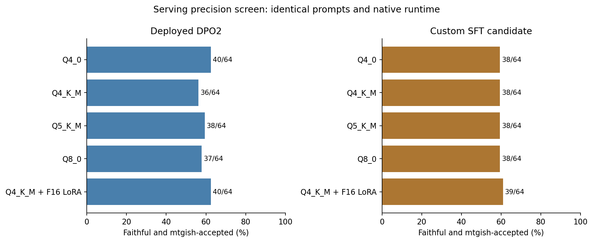

# Serving precision comparison

**No quality improvement large enough to justify a serving change was found.**
The custom-SFT candidate scored 38/64 for faithful, mtgish-accepted cards with
every merged quantization. A separate F16 adapter scored 39/64. The deployed DPO2
model scored 40/64 with Q4_0 and with a separate adapter; larger merged formats
scored 36–38/64. This small development screen does not establish equivalence or
rule out smaller differences. Keep the current serving model while reviewing
the next broad SFT checkpoint.

| Representation | Initial weights (GB) | DPO2: faithful + parsed | Custom SFT: faithful + parsed |
| --- | ---: | ---: | ---: |
| Q4_0, current | 2.37 | 40/64 | 38/64 |
| Q4_K_M | 2.50 | 36/64 | 38/64 |
| Q5_K_M | 2.89 | 38/64 | 38/64 |
| Q8_0 | 4.28 | 37/64 | 38/64 |
| Q4_K_M base + F16 adapter | 2.56 | 40/64 | 39/64 |



See [all format, intent and parser counts](results-table.md),
[panel results, paired comparisons and artifact identities](comparison.json),
and [individual outcome flags without card text](paired-outcomes.jsonl).
Sizes use decimal GB. The original locked 400-card test was not used.

The custom adapter's one-card gain comprises two gains and one loss against its
Q4_0 export; its descriptive family-bootstrap interval is −3.125 to +6.25
percentage points. DPO2's adapter has the same combined success/failure flags
as Q4_0 on this panel, but lower intent-only and schema totals. Neither result
demonstrates a quality gain. The separate-adapter route remains interesting for
smaller update downloads, subject to a browser loader change and device testing.

## Controlled experiment

The panel contains 64 requests: 32 independent custom-card families and 32
independent existing-development families, with one request per family. Selection
was frozen before generation: select up to four planeswalker families in each
panel, then fill by SHA256 of `serving-quant-v1:<case id>`. The custom panel has
one available planeswalker family; the existing panel contributes four.

Each model is served as Q4_0, Q4_K_M, Q5_K_M, Q8_0, or an original Q4_K_M base
plus its separate cumulative F16 LoRA. Merged exports are quantized directly
from the same F16 source, never from another quantized export. The separate
adapter experiment uses the pinned original base and retains the adapter as
an additional computation.

Every arm uses native llama.cpp build 11443 (`f0c41e016`), the production system
prompt, greedy decoding, seed 17, a 2,048-token output budget and a 4,096-token
context per request. Both rendered prompt bytes and token IDs are checked against
Transformers for every request. Four concurrent requests per server and two
model servers are held constant. All baselines are regenerated in this run.

mtgish uses the standard whole-card workflow. A blinded GPT-6.1-Sol reviewer at
medium effort checks the request against the displayed card, without seeing the
model, representation, reference answer or parser result. Identical displayed
submissions share a judgment. Schema failures, truncations and uncertain semantic
judgments stay in the denominator. Parser acceptance alone is not rules legality
or intent fidelity.

One Adventure request produces a preprocessing protocol error in every arm:
the generated faces put the Adventure spell first (or otherwise fail the
upstream check that the second face is an Adventure/Omen spell).
Upstream prints an unsupported-layout diagnostic on stdout followed by an empty
JSON array; the wrapper reports `parser_error`. This is not a grammar rejection
or a transient server outage. It is recorded separately in the machine-readable
metrics. Every version also fails semantic review, so resolving this parser
unknown cannot change the combined success counts. The frozen outputs and
parser workflow were not rewritten to make this example pass.

## Differences found in the serving paths

- Training-time NF4 inference adds the adapter to an NF4-quantized base. The
  deployed export merges the adapter into the original higher-precision base,
  then quantizes the combined weights. These are different numerical models.
  Q8 preserves more export precision, but is not an exact reconstruction of the
  training-time NF4 model.
- The tested Transformers and GGUF prompts have identical rendered bytes and
  token IDs. The production system prompt SHA256 is
  `620b723fc804360b14ae5ff4b19b65c43781c00ec52fc897e04346899587ecaa`.
- The browser normally uses temperature 0.7, top-p 0.8, top-k 20, min-p 0,
  a random seed and a 768-token limit. Evaluation uses greedy decoding and
  2,048 tokens. This affects comparability with interactive generations, but
  does not explain the earlier NF4-versus-GGUF comparison, where both arms used
  greedy decoding and the same 2,048-token limit.
- The alternate float32 browser backend still uses four-bit weights. Float32
  arithmetic is not a higher-precision weight export.
- The browser uses wllama 3.8.1 and its pinned llama.cpp revision
  `46ca246de9bb1c35269722a6240d37d9dfd79cad`, rather than the native evaluation
  build. Native CPU results cannot establish browser GPU quality or speed.

## Browser deployment considerations

The [pinned WebGPU backend](https://github.com/ggml-org/llama.cpp/blob/46ca246de9bb1c35269722a6240d37d9dfd79cad/ggml/src/ggml-webgpu/ggml-webgpu.cpp)
supports the tested K-quant and Q8 tensor types. That is source compatibility,
not a successful browser/device benchmark. Larger weights also increase download
and memory requirements; file size is not a measurement of peak memory.

Separate F16 adapters are 66,095,328 bytes each. Once a compatible base is
cached, a new adapter could therefore cost about 66 MB to download instead of
replacing the multi-gigabyte merged model. Initial base plus adapter loading is
2,563,374,176 bytes. Both base and adapter identities must key the model cache.

[wllama's loader](https://github.com/ngxson/wllama/blob/3.8.1/src/wllama.ts)
passes LoRA paths to the native runtime, but its
[Blob preparation](https://github.com/ngxson/wllama/blob/3.8.1/src/utils.ts)
classifies inputs as model shards or a vision projector. A separate adapter
needs explicit mounting rather than being added to the model-shard list. This
requires a loader extension and real-device validation before deployment.

An additional untested option is a domain-calibrated importance matrix:
[llama.cpp supports calibration-weighted quantization](https://github.com/ggml-org/llama.cpp/blob/master/tools/imatrix/README.md).
This can target quantization error without requiring an eight-bit download.
Any calibration should use training examples only and be evaluated separately;
it is not part of this ten-arm comparison or a demonstrated improvement here.

## Reproduction

The generation drivers are `src/serving_quantization.py` and
`src/serving_adapter_export.py`. The joint review driver,
`src/serving_joint_review.py`, reuses content-addressed judgments only when the
model, effort, rubric and displayed-card convention match. Each generation
manifest pins the model, adapter if present, runtime, cases, prompt and settings.

After those runs complete, publish aggregate diagnostics with:

```bash
python src/summarize_serving_quantization.py \
  --merged /data/serving-quants \
  --adapters /data/serving-adapters \
  --joint /data/serving-joint-review \
  --output reports/serving-quantization
```

This report excludes raw custom-card descriptions, card outputs and reviewer
transcripts. Aggregate counts, outcome flags and content hashes provide an audit
trail. Paired intervals resample complete card families with 5,000 bootstrap
draws. They are descriptive and are not adjusted for multiple comparisons or
model-judge uncertainty. The exact paired discordance test is also included for
these independent families. A bootstrap interval of zero when no discordances
were observed does not establish equivalence. No alternative improved combined
success significantly even before multiplicity adjustment. Small differences
on this panel require confirmation.
