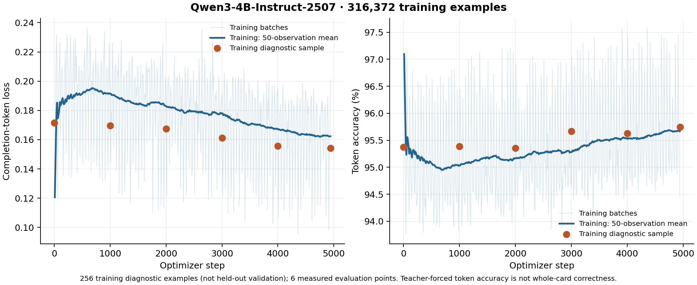

# Second SFT epoch: first quarter

**Completed: no measured generation improvement. Keep DPO2 deployed.**

The comparison finished on 2026-10-12 at 00:27 UTC. Continuing the original SFT
checkpoint for another quarter epoch reduced training diagnostic loss, but the
resulting Q4_0 export produced fewer cards that both followed the request and
passed mtgish than the deployed DPO2 export.

| Metric, out of 160 requests | Original SFT | Deployed DPO2 | SFT at 1.25 epochs |
| --- | ---: | ---: | ---: |
| Schema valid | 160 | 156 | 159 |
| Faithful to request | 102 | 99 | 99 |
| Accepted by mtgish | 74 | 76 | 76 |
| Faithful **and** accepted | 72 (45.0%) | **75 (46.9%)** | 70 (43.8%) |
| Faithful with highest Oracle style score | 98 | 98 | 92 |

The candidate lost five combined successes versus DPO2 and gained none. Versus
original SFT it gained three and lost five. This is an exploratory development
comparison with model judging, not proof that longer SFT can never help. The
result does not justify promoting this checkpoint or automatically spending on
the remaining three quarters of the epoch.

| Panel: faithful and accepted | Original SFT | DPO2 | SFT at 1.25 epochs |
| --- | ---: | ---: | ---: |
| Existing development, 128 requests / 96 families | 44 | 47 | 44 |
| Custom holdout, 32 requests / 32 families | 28 | 28 | 26 |

See [aggregate metrics, paired intervals and artifact identities](comparison.json)
and [individual outcome flags](paired-outcomes.jsonl). Raw requests, generated
card text and reviewer transcripts are excluded from this public report.

## Training and loss

The [HF job](https://huggingface.co/jobs/vishvananda/6acb888cfee2c90070195ff6)
ran on 2026-10-11 from 13:01 to 17:58 UTC. It continued the original SFT checkpoint for
4,944 additional optimizer updates with a new `3e-5` schedule, while preserving
the original full corpus, output serialization and family split. DPO and the
small repair/custom continuations were not starting weights for this run.

All 4,944 intended updates completed. The full second-epoch schedule remains
19,774 updates; this job stopped at the quarter mark and saved complete optimizer
state. Training took 4h 51m; allocated wall time was about 4h 57m, approximately
$12.38 at the quoted A100 rate (an estimate, not an invoice). The experiment's
$20 budget was not exceeded. No further training job was submitted.

The fixed 256-example **training diagnostic** loss fell from 0.171423 to
0.154185, approximately 10.1%. Teacher-forced token accuracy rose from 95.372%
to 95.749%. These examples belong to the training split; these numbers are
neither held-out validation nor card-generation accuracy.



[Training summary](training-summary.json), [raw training observations](training-curve.csv)
and [SVG](training-curve.svg) are available. The smoothed line averages the last
50 logged observations (logging occurs every ten updates). Diagnostic markers
show only actual measurements at steps 0, 1000, 2000, 3000, 4000 and 4944.

Full resumable checkpoint files were verified in private training storage.
The inference adapter is published at the immutable HF tag
[`epoch2-quarter-train-step-00024718`](https://huggingface.co/vishvananda/mtg-oracle-qwen3-4b-checkpoints-20261007/tree/epoch2-quarter-train-step-00024718).
Publication does not promote the model. A separate 66,095,328-byte F16 GGUF
adapter was also exported for the future smaller-download workflow.

## Comparison controls and limitations

The frozen panel contains 160 requests in 128 families: 128 existing development
requests and 32 custom-card requests. It is a new-request diagnostic, not an
estimate of unseen-SFT-card accuracy. The original locked 400-card final test
was not used for checkpoint selection.

All three arms were generated afresh using native llama.cpp b11443, Q4_0,
the same production prompt, greedy decoding, seed 17, a 2,048-token output
budget and a 4,096-token context per request. Prompt bytes and token IDs were
audited. Each server used eight CPU threads and four concurrent requests.
These are local quality measurements, not browser GPU performance tests; they
do not enable CPU fallback in the application.

mtgish uses the pinned standard whole-card workflow. A blinded GPT-6.1-Sol
reviewer at medium effort judges request fidelity without the model identity,
reference answer or parser result. Identical displayed submissions share a
judgment. CARDNAME is bound to the displayed card name for judging; original
outputs and parser inputs are retained. Schema and explicit-field failures,
truncations, and uncertain judgments remain in the denominator. Parser
acceptance alone does not establish official rules legality or balance.

Four outputs produced preprocessing protocol errors, counted separately from
grammar rejection: one Adventure output per model, plus a reversible-layout
output from the new candidate. Rechecking the upstream preprocessor confirmed
that it prints a layout diagnostic before an empty JSON array. All four also
fail intent review, so resolving the parser unknowns cannot change the combined
success counts. The outputs were not rewritten to make them pass.

Paired intervals resample complete families with 5,000 bootstrap draws and seed
43. The candidate-minus-DPO2 difference is -3.125 percentage points, with a
descriptive interval of -6.061 to -0.633. Candidate-minus-original-SFT is -1.25
points, with interval -4.545 to +1.974. These intervals are not corrected for
multiple comparisons or model-judge uncertainty, and can be overconfident with
few discordant families. They should not be treated as a definitive significance
claim. The observed counts support retaining the current serving model.

The [recipe and continuation policy](../../docs/second-sft-epoch.md) document
preparation, launch, checkpoint recovery and the `src/sft_checkpoint_review.py`
review driver. The curves can be regenerated with:

```bash
python src/plot_training.py \
  --summary reports/sft-second-epoch/training-summary.json \
  --state /data/epoch2-quarter/gpu/checkpoints/checkpoint-4944/trainer_state.json \
  --output reports/sft-second-epoch
```

The independent [serving precision experiment](../serving-quantization/README.md)
is complete: ten arms on 64 frozen development cases found no demonstrated
quality advantage from larger merged exports. Separate F16 LoRA loading matched
DPO2's combined score and improved custom SFT by one card. It offers a potential
66 MB update path. [Loader preparation](../../docs/separate-browser-adapters.md)
is complete; real-device GPU validation remains necessary before deployment.
